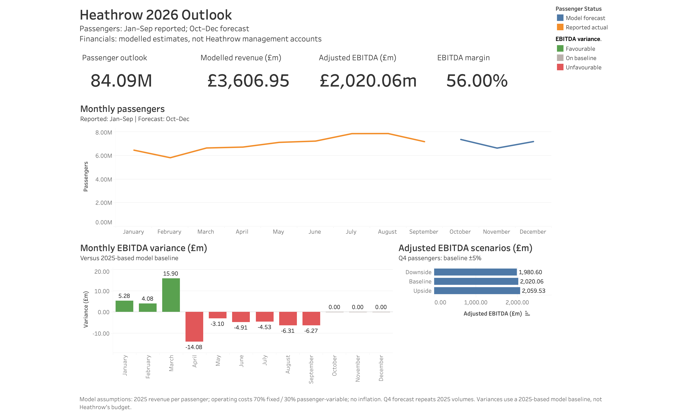

# Heathrow Passenger, Revenue and Cost Forecasting Model

A portfolio project using Python, SQLite and Tableau to connect Heathrow passenger activity with modelled revenue, operating costs and adjusted EBITDA.

## Dashboard

Open `tableau/heathrow_2026_outlook_v2.twbx` in Tableau to explore the workbook.

## Scope

- Monthly passenger analysis: October 2024–September 2026.
- Passenger forecast: October–December 2026.
- Annual financial benchmarks: 2024 and 2025.
- Monthly and year-to-date variances against a 2025-based model baseline.
- Baseline, upside and downside passenger scenarios.

Passenger observations and annual financial benchmarks come from published Heathrow information. Monthly financial figures are modelled estimates, not Heathrow management accounts. The comparison baseline is not Heathrow’s internal budget.

## Data sources

- [Heathrow traffic statistics](https://www.heathrow.com/company/investor-centre/reports/traffic-statistics)
- Heathrow (SP) Limited FY 2025 financial results, including 2024 comparatives.

Original source files are retained in `data/raw/`:

- `sep-2026-traffic-statistics.xlsx`
- `Heathrow_(SP)_Limited_FY_2025.pdf`

## Methods

- Validate dates, missing values, duplicate months and passenger totals.
- Compare naïve and seasonal naïve passenger forecasts over a six-month holdout period.
- Forecast Q4 passengers using the corresponding 2025 months.
- Apply 2025 revenue per passenger to model revenue.
- Assume operating costs are 70% fixed and 30% passenger-variable.
- Calculate financial variances and reconcile revenue, cost and EBITDA movements.
- Use SQLite queries to prepare Tableau dashboard exports.

## Main results

| Measure | 2026 model outlook |
|---|---:|
| Passengers | 84.09 million |
| Revenue | £3,606.95m |
| Adjusted operating costs | £1,586.89m |
| Adjusted EBITDA | £2,020.06m |
| Adjusted EBITDA margin | 56.00% |

- Seasonal naïve holdout MAPE: 2.44%, compared with 9.05% for naïve.
- Passenger outlook: 0.44% below reported 2025 passengers.
- January–September modelled EBITDA: £13.94m below baseline (-0.92%).
- A ±5% Q4 passenger change moves annual modelled EBITDA by approximately ±£39.46m.

## Notebooks

Run these in order:

1. `notebooks/01_data_collection_and_audit.ipynb`
2. `notebooks/02_passenger_analysis_and_forecasting.ipynb`
3. `notebooks/03_financial_model_and_variances.ipynb`
4. `notebooks/04_sql_analysis_and_dashboard_exports.ipynb`

## Reproducing the analysis

Use the `lewagon_current` Python environment.

From the project folder, install dependencies with:
`python -m pip install -r requirements.txt`

Place the original source files in `data/raw/`, then run the four notebooks in order.

The notebooks generate processed CSV files, the SQLite database and Tableau CSV exports. SQL queries are saved in `sql/`.

## Assumptions and limitations

- All monthly financial results are modelled, including months with reported passenger observations.
- Revenue per passenger remains at the 2025 benchmark.
- The 70% fixed / 30% variable cost split is an illustrative assumption.
- The model assumes no inflation or changes in revenue yield.
- Q4 baseline forecast variances are zero by construction because the forecast repeats prior-year passenger volumes.
- Scenario changes apply only to Q4 passenger volumes.
- Forecast evaluation covers one six-month holdout period.
- Adjusted EBITDA excludes depreciation, amortisation, interest and tax; it is not net profit or cash flow.
- Detailed internal budgets and cost-centre accounts are outside the project scope.